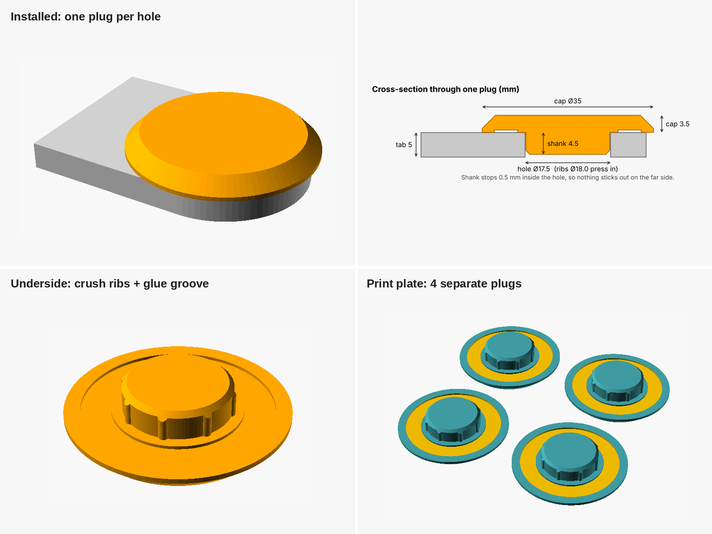

# Gate hole plugs (child safety)

Four separate plugs, one for each hole in the padlock tabs on the gate, so a
child can't put a finger into a hole.



## What to print

| File | What it is |
|---|---|
| `stl/plugs_x4.stl` | The 4 plugs, laid out for printing |
| `stl/plug_single.stl` | One plug, for printing a test fit first |
| `stl/size_gauge.stl` | Optional sizing gauge (see below) |
| `gate_hole_plug.scad` | Editable OpenSCAD source |

**Default sizes** are estimated from the photos (tape measure against the tab):
hole **Ø17.5 mm**, tab **5 mm** thick. I took them from photos, so either:

- print `plug_single.stl` first and check it fits, or
- print `size_gauge.stl`, measure, then rebuild (below).

### Print settings

- Material: **white PLA**, to match the gate. PLA is fine because this gate
  is in the shade. If a gate gets direct sun, use PETG or ASA instead, since
  PLA softens at around 55 °C.
- As laid out: flat top of the cap on the bed, shank up. No supports.
- 0.2 mm layers, 3 walls, 40% infill.

### Print with Codex

Run this from a clone of the repo on the computer connected to the printer:

```
codex "In this repo, check out branch claude/laughing-archimedes-ua7u9a and slice gate-hole-plugs/stl/plugs_x4.stl (4 separate plugs, already oriented: flat cap on the bed, shank up; do not rotate or scale). Print it in WHITE PLA with: 0.4 mm nozzle, 0.2 mm layers, 3 walls, 4 top and 4 bottom layers, 40% gyroid infill, no supports, no brim, nozzle 210 C, bed 60 C. Use whatever slicer/printer tools are on this machine (Bambu Studio, OrcaSlicer, PrusaSlicer, Cura, OctoPrint or Moonraker). If the printer has several spools or an AMS, pick the white PLA one. Before starting, show me the estimated print time and filament use and wait for my OK."
```

To print one test plug first, swap `plugs_x4.stl` for `plug_single.stl`.

## Using the size gauge

- **Hole:** push the round pegs into the hole. The **largest peg that goes
  in** is your `hole_d`.
- **Thickness:** slide the slots on the top edge over the edge of the tab.
  The **narrowest slot that slides on** is your `tab_t`.

The gauge comes off the same printer as the plugs, so any printer error is
already included in the number.

## Changing the size

Open `gate_hole_plug.scad` in [OpenSCAD](https://openscad.org), set these two
lines at the top, then **Render (F6)** and **Export STL**:

```
hole_d = 17.5;   // hole diameter
tab_t  = 5.0;    // tab thickness
```

From the command line:

```
openscad -o plugs_x4.stl -D hole_d=18 -D tab_t=6 gate_hole_plug.scad
```

## Fitting

1. Clean the hole and the area around it on the **cap side**: wire-brush off
   loose paint and rust.
2. Put the cap on the **outer face** of each tab, the side away from the other
   tab. The shank stops 0.5 mm inside the hole, so nothing sticks out on the
   other side and the gate still closes.
3. Put a thin bead of **outdoor adhesive** in the groove under the cap and a
   little on the shank. Good options: MS-polymer (e.g. Sikaflex, Soudal Fix
   All) or 2-part epoxy.
4. Press it in. The ribs are a tight fit, so give it a few light taps with a
   rubber mallet until the cap sits flat. Leave it to cure.

Without glue the ribs alone hold it quite firmly, but a determined toddler
could work it loose. **Glue them in.** The cap is 35 mm across, which is too
big to swallow (the choke-test size is 31.7 mm). Even so, check now and then
that all four are still there.

To remove later (e.g. to use a padlock again), lever under the cap edge with a
flat screwdriver.
